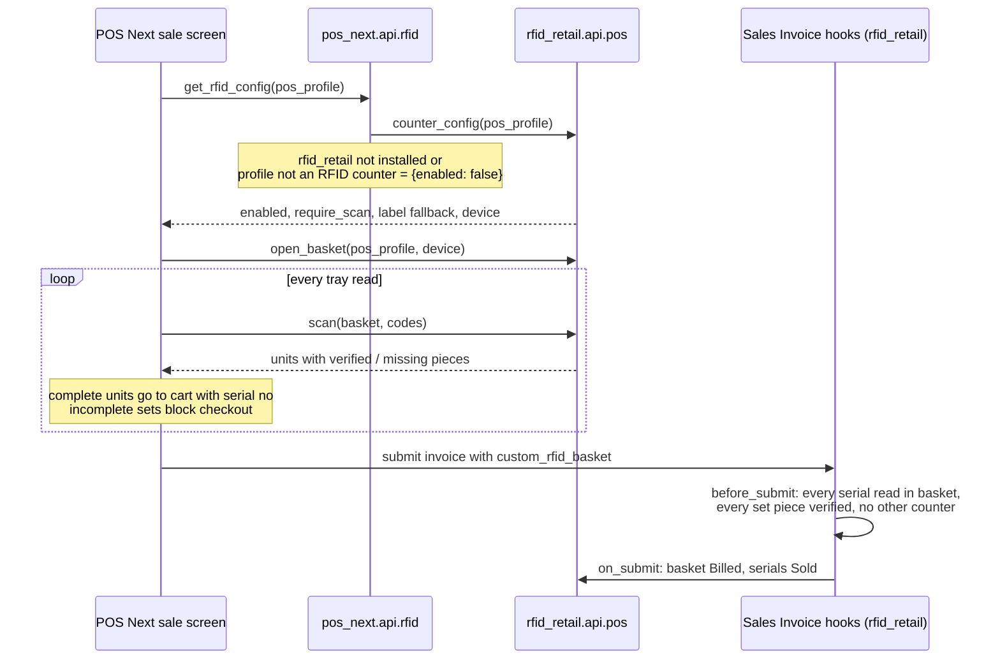

## RFID Retail

RFID garment identity, set billing, tag lifecycle and stock audit for ERPNext retail.

Every sellable garment gets a Serial No, and every physical piece of it carries an RFID tag.
The app knows which tag belongs to which piece, makes sure a multi-piece set (suit = jacket +
trouser) is only billed when every piece is actually at the counter, and tracks each tag from
inward through sale, detach, return and re-tag. A daily handheld count shows what is on the
floor versus what ERPNext thinks is there.

Works with standard ERPNext Sales / POS Invoices. When [POS Next](#pos-next-integration) is
installed it adds an RFID tray to the POS Next sale screen.

### Features

**Master switch and station access** (`RFID Settings`)
- `Enable RFID` off = the app is inert: no invoice checks, no stations, no schedulers. Sites can
  install it and switch it on later.
- Sale rules: require a tray read for every tagged unit, accept printed labels as a fallback when
  a tag will not read, optionally block any stock item that has no RFID identity.
- Device and audit rules: mark a reader offline after N minutes silent, require a daily handheld
  count.
- Station access table: map each station (Billing, Tag Mapping, Tag Repair, Detach, Exit Gate,
  Device API, Stock Audit, Audit Review, Manager Override) to any roles. Every API checks it.
- Roles created on install: RFID Owner, RFID Store Manager, RFID Cashier, RFID Stock Operator,
  RFID Device.

**Garment identity**
- `RFID Tracked Garment` and `Style Code` on Item; `RFID Status`, `Is Garment Set`,
  `On Counter Basket` and `Sold On` on Serial No.
- `Garment Set Definition` on an item template lists its pieces (`Garment Piece` master, e.g.
  JKT, TRS), with an option to allow mixed piece sizes.
- On submit of a Purchase Receipt, Purchase Invoice, Stock Entry or Stock Reconciliation, each
  inward serial of a set gets its `Garment Component` rows (`<serial>-JKT`, `<serial>-TRS`, ...)
  created automatically.
- `RFID Tag` with status (Available, Assigned, Sold - Pending Detach, Hold, Damaged, Retired) and
  a full `RFID Tag Assignment` history.

**Tag mapping and repair**
- Guided tagging screen: pending units list, scan a tag, bind it to a serial or a set piece.
- Replace a damaged tag (old tag retired, history kept).
- Detach after sale, customer return check before a returned unit is re-tagged, send a piece out
  for alteration and back.

**Counter billing**
- `RFID Basket` per counter: tray reads are added to the basket, one line per sellable unit with
  each piece shown as verified or missing.
- A set cannot be billed until every piece is read. A unit cannot sit on two counters at once.
- Checkout creates the Sales Invoice, marks serials Sold and tags Sold - Pending Detach; retrying
  a billed basket returns the same invoice. Customer lookup / create by mobile and loyalty points.
- The same rules are enforced in `Sales Invoice` / `POS Invoice` `before_submit`, so a desk
  invoice or any other frontend cannot bypass them. Cancel and return reverse the status.

**Exit gate and devices**
- `RFID Device` (Desktop Reader, Tray Reader, Handheld, Exit Gate) linked to a POS Profile or
  warehouse, with heartbeat health.
- Gate reads alarm on any tag whose current assignment is not sold. Devices silent past the
  limit go Offline (checked every 5 minutes).

**Handheld stock audit**
- `RFID Audit Session` freezes the expected stock for a warehouse (full store or partial area),
  accepts idempotent batch uploads from a handheld, and compares.
- Results: Matched, Unverified, Confirmed Shortage, Unexpected, Unmapped, Sold but Observed,
  Incomplete Set, Held Outside Store, with a resolution per line.
- Live checklist while counting, numbered steps, discard a mistaken count, submit for review;
  the reviewer must be a different user than the operator. A Missed Audit is raised at 23:00 if
  no count was compared that day.

**Exceptions log** (`RFID Exception`)
- One place for everything that went wrong: Unmapped Tag, Duplicate Assignment, Sold Tag Read,
  Retired Tag Read, Counter Conflict, Incomplete Set, Exit Alert, Barcode Fallback, Tag Replaced,
  Device Offline, Audit Shortage, Audit Unexpected, Missed Audit, Unconfirmed Detach, Manual
  Override. Each has severity, status and links to the serial, piece, device and document.

**Station app** (`/rfid`)
- Mobile-first web page for store staff. It shows only the stations the user's roles allow.
  The Billing tile opens POS Next.
- RFID sections on the Item, Serial No, Sales Invoice, POS Profile and Warehouse dashboards.

**Item codes** (`RFID Settings > Item Codes`, own switch, works with RFID off)
- Build item codes and names from patterns, e.g. `{supplier_code}-{item_name}` and
  `{template}-{attr_abbrs}` for variants: `ZOD-FORMAL-SHIRT-RED-40`, "Formal Shirt Red 40".
- Tokens: `{supplier_code}` `{supplier}` `{item_name}` `{item_group}` `{brand}` `{style_code}`
  `{template}` `{template_name}` `{attr_abbrs}` `{attr_values}` `{attr:Colour}` `{value:Colour}`
  `{###}` (running number per prefix). An empty token drops with its separator.
- Supplier comes from the new `Supplier` field on Item (or the first Item Supplier row);
  its code from `Item Code Prefix` on Supplier, else the first letters of its name.
- Applies when Item Code is left blank, and to every new variant. A typed code always wins.
  A code that already exists is rejected as a duplicate.

**Barcodes and labels** (`RFID Settings > Barcodes & Labels`, own switch, works with RFID off)
- Every new stock item gets a barcode: EAN-13 with check digit (in-store `2x` range or your GS1
  prefix), a plain number, or the item code. Items that already carry a supplier barcode keep it.
- `Label Print Job`: one row per label source, with copies. Built from a Purchase Receipt,
  Purchase Invoice with Update Stock, Stock Entry or Stock Reconciliation (`Print Labels` button),
  from selected Items or Serial Nos (list action), or from stock on hand in a warehouse.
  Optionally created automatically whenever stock is received.
- What a label encodes: a serial-tracked unit prints its Serial No (one label per piece), a set
  piece prints its component code (`SUIT-000125-JKT`), anything else prints the item barcode,
  one label per unit. These are the codes the RFID counter accepts as label fallback.
- `Retail Barcode Label` print format: name, size/colour, barcode, code, price and store name,
  scaled to any label size (width, height, labels across the roll, gap set in settings).

**Invoice print formats**
- `Retail Tax Invoice` (A4) and `Retail Receipt` (80 mm thermal) for Sales Invoice.
- Seller block from the company address, GST tax per HSN from `item_wise_tax_detail` (correct on
  tax-inclusive POS bills), serial numbers per line, payments, Credit Note title for returns.

**API**
- Every action above is a whitelisted method, usable by device bridges and custom frontends with
  an API key. See [API.md](API.md).

### POS Next integration

The two apps do not import each other. POS Next ships one small optional bridge, and
`rfid_retail` owns all the RFID data and rules.



1. Mark the counter: tick **RFID Counter** (`custom_rfid_counter`) on the POS Profile and link a
   Tray Reader `RFID Device` to it.
2. When POS Next opens a shift on that profile it calls `pos_next.api.rfid.get_rfid_config`.
   That method returns `{enabled: false}` unless `rfid_retail` is installed, and then asks
   `rfid_retail.api.pos.counter_config`. RFID mode turns on only when RFID Settings is enabled
   and the profile is an RFID counter.
3. In RFID mode POS Next shows the tray panel and sends reads to `open_basket`, `scan`,
   `remove_unit` and `cancel_basket`. Complete units go into the normal POS Next cart with
   their serial numbers. Incomplete sets stay in the panel and block checkout. If
   *require scan* is on, tagged items cannot be picked from the item grid by hand.
4. POS Next submits its invoice as usual, carrying `custom_rfid_basket` on the header.
   `rfid_retail`'s `before_submit` then checks every unit again against that basket, so the
   frontend cannot bypass the rules. `on_submit` marks the basket Billed and the serials Sold.
5. The open basket survives a page reload. RFID mode needs a connection, so offline checkout is
   blocked on RFID counters.

Without `rfid_retail` (or with RFID switched off) POS Next behaves exactly as before.

POS Next with RFID mode: [tushar-git26/POSNext, branch `feat/rfid-mode`](https://github.com/tushar-git26/POSNext/tree/feat/rfid-mode).

### Installation

```bash
cd $PATH_TO_YOUR_BENCH
bench get-app https://github.com/tushar-git26/rfid_retail --branch main
bench --site <site> install-app rfid_retail
```

Then open **RFID Settings**, tick **Enable RFID**, and adjust the station roles. Requires ERPNext
v15. Client-specific masters (items, set definitions, devices) are set up per site, not shipped
with the app.

### Contributing

This app uses `pre-commit` for code formatting and linting. Please [install pre-commit](https://pre-commit.com/#installation) and enable it for this repository:

```bash
cd apps/rfid_retail
pre-commit install
```

Pre-commit is configured to use the following tools for checking and formatting your code:

- ruff
- eslint
- prettier
- pyupgrade

### License

mit
